# Archipiélago VirtuX

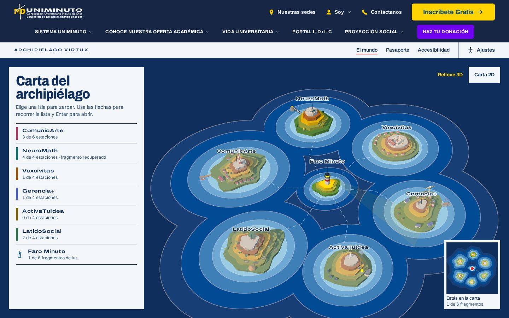

     

**El ecosistema VirtuXperience de UNIMINUTO convertido en un mundo explorable.** Cada línea de formación es una isla con su sendero de estaciones, un reto jugable en 3D y una Bruma que vencer. Brújula, una guía con IA que funciona sin conexión, adapta la dificultad. Al reunir los seis fragmentos de luz, el Faro Minuto se enciende.

- **Demo web**: se despliega en Vercel con [`vercel.json`](vercel.json) (ver [Despliegue](#despliegue-web)).
- **Ejecutable «Virtual Experience Engineering SAS»**: instalador y portable de Windows y AppImage de Linux en la sección _Releases_ del repositorio, generados por [`release.yml`](.github/workflows/release.yml).
- **Evidencias**: [`docs/evidencias/`](docs/evidencias/), generadas con `pnpm evidencias`.

## Inicio rápido para evaluadores

1. `pnpm install` (Node 24 y pnpm 9).
2. `pnpm dev` y abre <http://localhost:5173/mundo?demo=1>. El modo demo precarga tres días de expedición: NeuroMath completa, las seis islas visitadas y 8 insignias.
3. En la carta, elige **ComunicArte** (flechas y Enter) y abre la **Sala de Redacción**, que ya está lista para jugar.
4. Juega el reto en 3D o en su versión accesible, y mira el resultado en **Pasaporte**.
5. Pulsa **Alt + A** en cualquier página para el panel de accesibilidad, o prueba la **Carta 2D**.

Todo se puede recorrer solo con teclado. Sin WebGL, el mundo pasa a la carta 2D y los juegos a su versión accesible.

## Concepto

El estudiante llega como Explorador/a a un archipiélago donde el **Faro Minuto** perdió su luz. Cada isla guarda un **fragmento de luz** que se recupera desarrollando su competencia. **Brújula** acompaña, da pistas y sugiere el camino. Cada isla tiene su **Bruma**, la niebla de un mal hábito (los rumores, el cálculo a ciegas, la indiferencia…), que se vence usando bien lo aprendido. Con los seis fragmentos se abre el **Gran Reto Integrador** contra la Gran Bruma. Detalle en [docs/narrativa.md](docs/narrativa.md).

| Isla         | Lugar                              | Competencia                                | Reto 3D               | Arena contra la Bruma        |
| ------------ | ---------------------------------- | ------------------------------------------ | --------------------- | ---------------------------- |
| ComunicArte  | Ciudad-puerto con imprenta y radio | Comunicación y verificación de información | Sala de Redacción     | Verificar los rumores        |
| NeuroMath    | Observatorio y puentes geométricos | Pensamiento lógico-matemático              | Puentes de Fractal    | Reconstruir el puente de luz |
| Voxcivitas   | Plaza pública con cabildo          | Ciudadanía, ética y proyecto de vida       | Sesión de cabildo     | Moderar la plaza             |
| Gerencia+    | Astillero y mercado                | Gestión, decisiones y liderazgo            | Día de mercado        | Llevar el timón              |
| ActivaTuIdea | Taller-laboratorio maker           | Emprendimiento e innovación                | Banco de pruebas      | Prototipar el cañón de luz   |
| LatidoSocial | Bosque comunitario y huerta        | Proyección social y bienestar              | La huerta comunitaria | Defender el bosque juntos    |

## Cómo responde a los ocho requerimientos

| Requerimiento             | Implementación                                                                                                                                                                                                    | Dónde                                                                  |
| ------------------------- | ----------------------------------------------------------------------------------------------------------------------------------------------------------------------------------------------------------------- | ---------------------------------------------------------------------- |
| 1. Mundo inmersivo        | Archipiélago 3D low-poly con océano, relieve en terrazas, faro y rutas; vuelo de cámara entre islas; carta 2D equivalente                                                                                         | `src/world/`, `src/landing/`                                           |
| 2. Arquitectura narrativa | Faro Minuto, fragmentos de luz, Brújula, una Bruma por isla y el Gran Reto; vocabulario del mundo en toda la interfaz                                                                                             | [docs/narrativa.md](docs/narrativa.md), `src/data/`                    |
| 3. Rutas de aprendizaje   | 6 islas = 6 líneas VirtuXperience, 26 estaciones en senderos con orden sugerido; contenido en JSON validado con Zod                                                                                               | [docs/pedagogia.md](docs/pedagogia.md), `src/data/`                    |
| 4. Interacción            | Paradas 3D con estado y las 26 estaciones jugables en 3D: se camina por la plaza de cada isla hasta los formatos, los faroles de respuesta y la bitácora; teclado completo, táctil, minimapa, lectura en voz alta | `src/world/`, `src/games/stations/`, `src/stations/`                   |
| 5. Reto / simulación      | Seis retos y seis arenas en 3D, cada uno con su propia mecánica, y versión accesible equivalente; Gran Reto que encadena las seis arenas                                                                          | `src/games/`, `src/minigames/`, [docs/juegos-3d.md](docs/juegos-3d.md) |
| 6. IA                     | Motor adaptativo local (Elo con paso decreciente) para dificultad, pistas y formatos; Brújula con LLM opcional vía proxy                                                                                          | `src/ai/`, `server/`, [docs/ia.md](docs/ia.md)                         |
| 7. Progreso               | XP, 4 niveles de explorador, 3 de competencia, fragmentos, 23 insignias, bitácora y pasaporte exportable; modo demo                                                                                               | `src/progress/`, `src/passport/`                                       |
| 8. Accesibilidad / DUA    | Panel con Alt + A, alto contraste, letra para dislexia, espaciado, movimiento reducido, voz, carta 2D, juegos accesibles; axe sin violaciones graves                                                              | `src/a11y/`, [docs/accesibilidad.md](docs/accesibilidad.md)            |

## Funcionalidades

**Landing cinematográfica**: hero 3D, manifiesto revelado con el scroll, recorrido por las seis islas, Brújula, DUA con ajustes en vivo y vista previa del pasaporte.

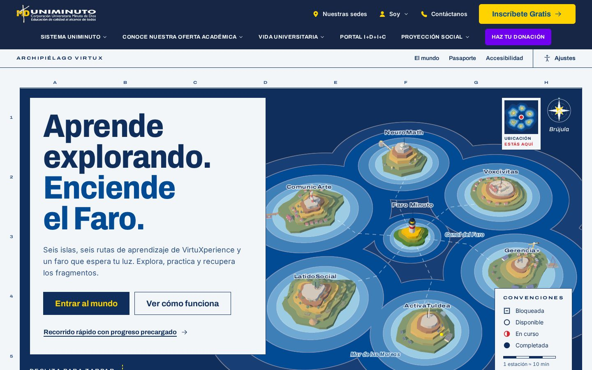

**La carta y cada isla**: la cámara vuela a la isla y su sendero muestra el estado de cada estación (bloqueada, disponible, en curso, completada). Brújula marca la siguiente.

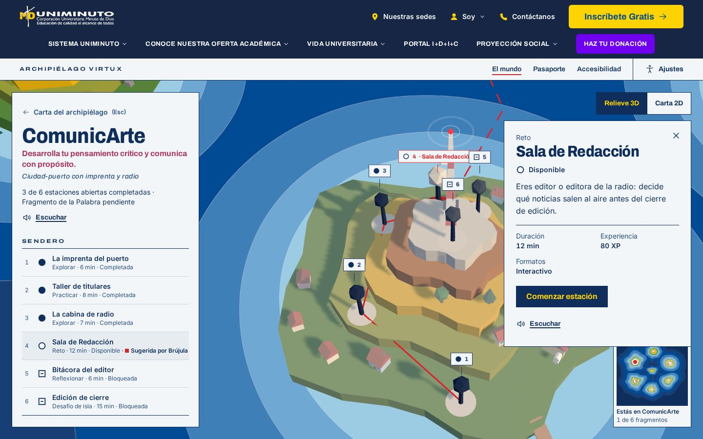

**Todas las estaciones en 3D**: en Explorar, Practicar y Reflexionar se camina por la plaza de la isla, rodeada de su lugar (la radio y la imprenta de ComunicArte, la ceiba de LatidoSocial…). Los formatos son objetos a los que se camina y las respuestas son faroles.

| Explorar en ComunicArte                                                    | Practicar en NeuroMath                                                    |
| -------------------------------------------------------------------------- | ------------------------------------------------------------------------- |
| 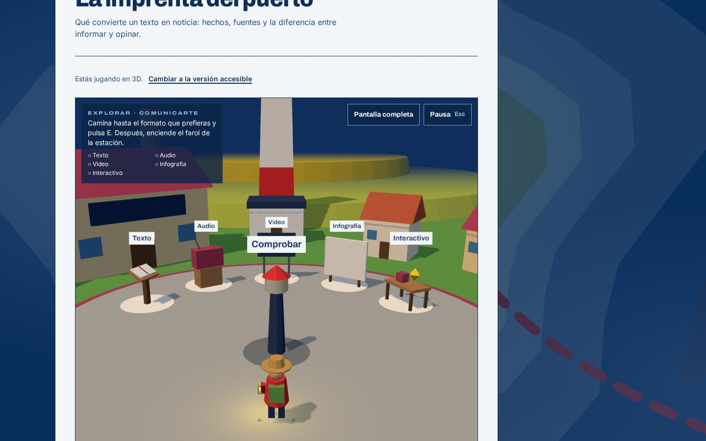 | 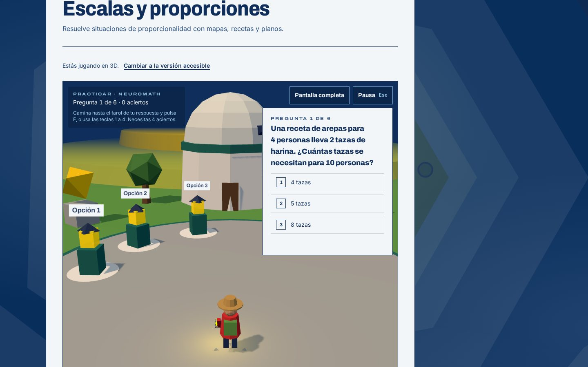 |

**Doce juegos 3D**: cada isla tiene un reto con su propia dinámica y una arena de acción y conocimiento contra su Bruma, donde la linterna solo se carga usando bien la competencia de la isla.

| Reto                                                          | Arena                                                              |
| ------------------------------------------------------------- | ------------------------------------------------------------------ |
| 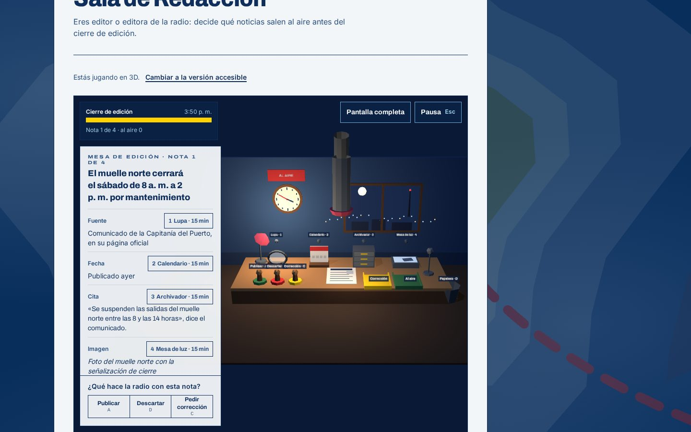 | 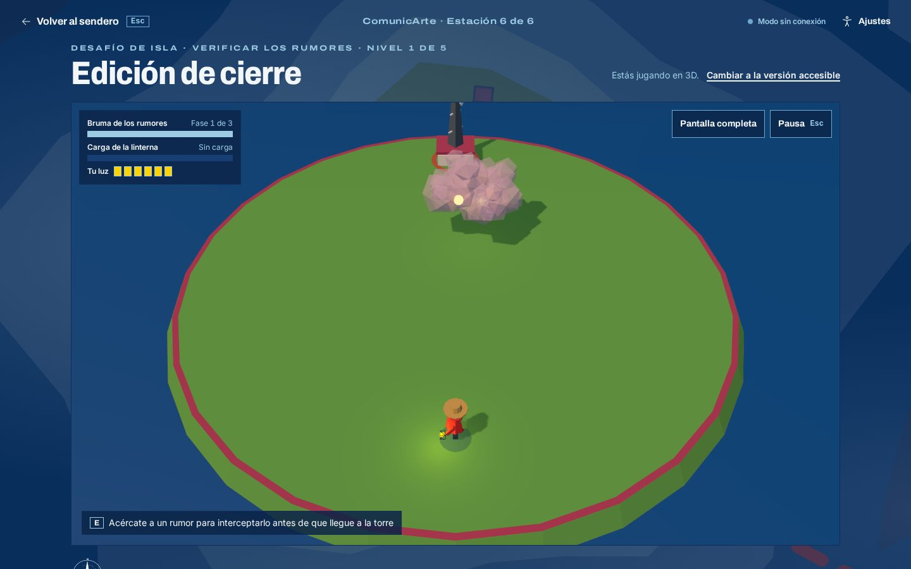 |
| 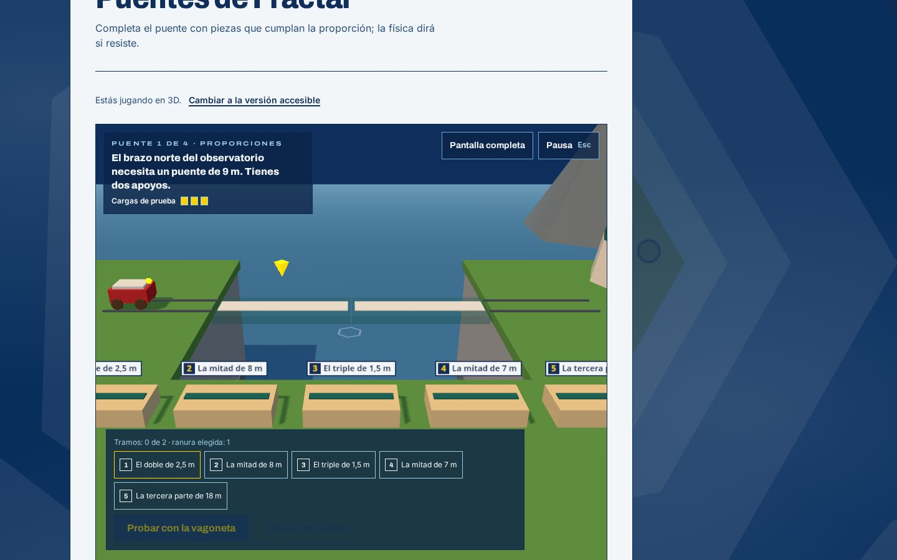  | 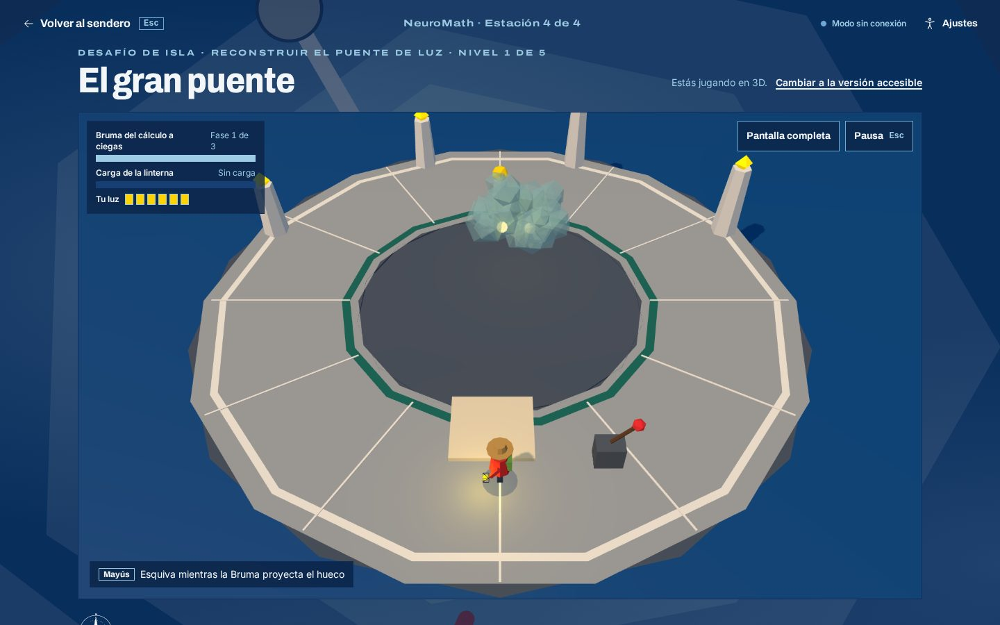           |
| 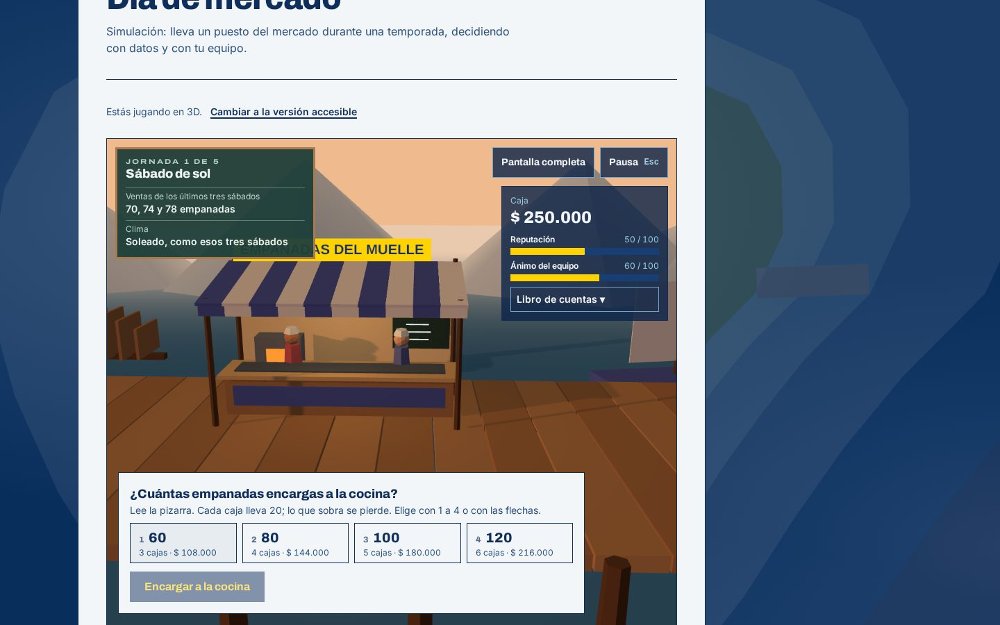       | 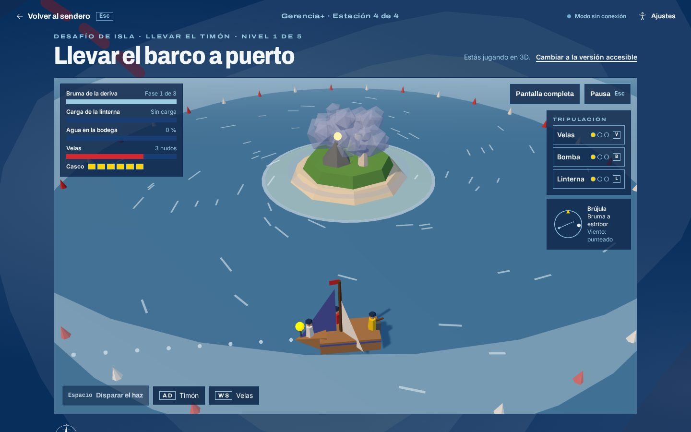          |

Las seis islas están en [docs/evidencias/](docs/evidencias/) y su diseño, en [docs/juegos-3d.md](docs/juegos-3d.md).

**Pasaporte**: nivel, fragmentos, sellos con fecha, avance hacia las insignias por sellar y bitácora por días. Se exporta como imagen PNG o se imprime en PDF.

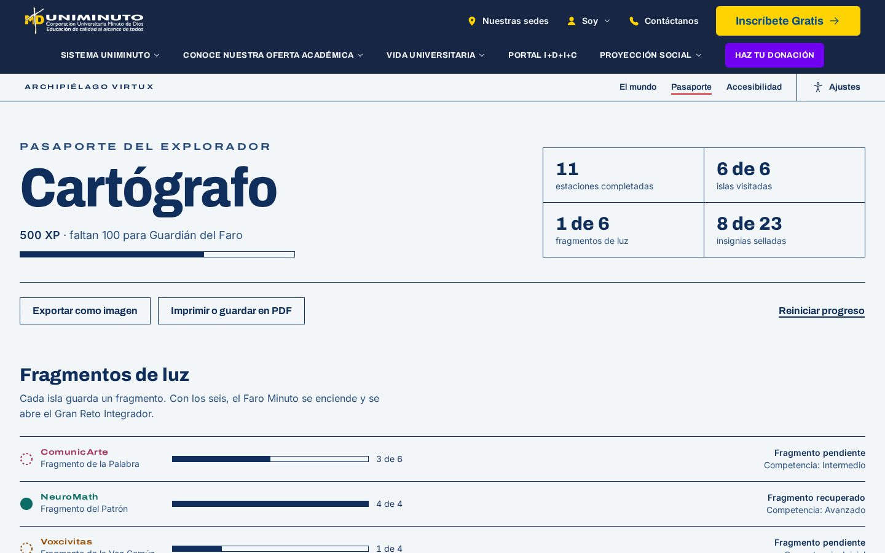

**Accesibilidad**: panel siempre a un clic (Alt + A) y carta 2D equivalente, aquí en alto contraste.

| Panel                                                | Carta 2D en alto contraste                                  |
| ---------------------------------------------------- | ----------------------------------------------------------- |
| 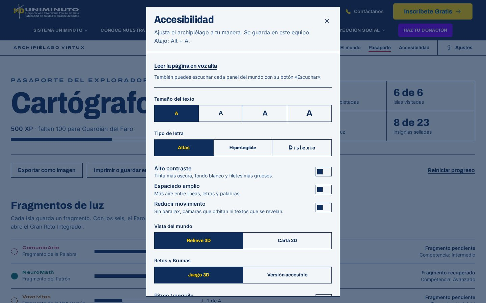 | 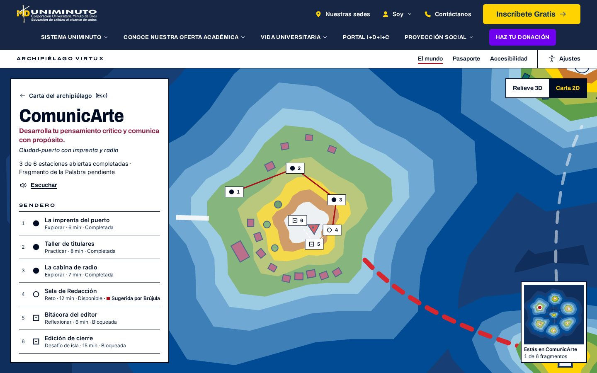 |

## Arquitectura

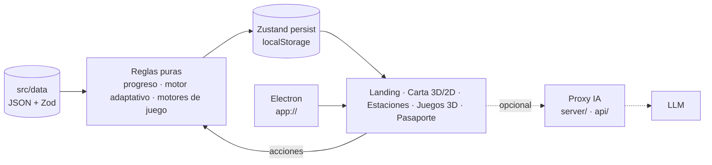

- **El contenido es dato**: una ruta nueva se agrega con JSON, sin tocar componentes.
- **Las reglas son módulos puros probados**: los componentes 3D leen el estado y emiten eventos.
- **Rutas con carga diferida**: la landing no espera al mundo 3D.

Detalle en [docs/arquitectura.md](docs/arquitectura.md). Las decisiones de diseño están en los ADR de [docs/adr/](docs/adr/): stack, enrutado, mundo navegable, juegos 3D y ejecutable.

## Tecnologías

| Capa       | Tecnología                                                           | Por qué                                                                         |
| ---------- | -------------------------------------------------------------------- | ------------------------------------------------------------------------------- |
| Base       | Vite 8, React 19, TypeScript strict                                  | Rápido, tipado de punta a punta                                                 |
| 3D         | three.js, @react-three/fiber 9, drei 10                              | Escenas declarativas; todo el 3D se genera con primitivas, sin modelos externos |
| Animación  | Motion, GSAP + ScrollTrigger, Lenis                                  | Micro-interacciones y relato con el scroll                                      |
| Estado     | Zustand con `persist`, validado con Zod al cargar                    | Simple, testeable, sin servidor                                                 |
| Estilos    | Tailwind CSS 4 con tokens propios                                    | Paleta cerrada del atlas y modos de accesibilidad como tokens                   |
| Voz        | Web Speech API                                                       | Lectura en voz alta sin red                                                     |
| IA         | Motor local + proxy compatible con OpenAI (Groq, Gemini, OpenRouter) | Funciona offline; la API key nunca llega al cliente                             |
| Escritorio | Electron 44 + electron-builder 26                                    | Ejecutable Windows y Linux sin internet                                         |
| Pruebas    | Vitest, Testing Library, Playwright, axe-core                        | Unidad, extremo a extremo, accesibilidad y ejecutable                           |
| Calidad    | ESLint (type-checked), Prettier, Husky, lint-staged, commitlint      | Repositorio consistente y commits convencionales                                |

## Instalación y ejecución

**Requisitos**: Node 24 LTS (`.nvmrc`) y pnpm 9 (`npm i -g pnpm@9`).

```bash
pnpm install
pnpm dev              # web en http://localhost:5173
pnpm build            # build de producción en dist/
pnpm preview          # sirve el build en http://localhost:4173
```

### Ejecutable de escritorio

```bash
pnpm dist:win         # Windows: instalador NSIS + portable (en Windows, o en Linux con Wine)
pnpm dist:linux       # Linux: AppImage
pnpm electron:start   # abre el build en Electron sin empaquetar
pnpm electron:dev     # Electron sobre el servidor de desarrollo (con pnpm dev en otra terminal)
```

Los binarios quedan en `release/`. Al crear un tag `v*`, [`release.yml`](.github/workflows/release.yml) los compila en Windows y en Linux, prueba cada uno con Playwright y los adjunta al Release.

- **Requisitos del equipo**: Windows 10/11 de 64 bits o Linux x64, 4 GB de RAM y una GPU con WebGL 2. Sin GPU compatible, la app usa la carta 2D y los juegos accesibles.
- **Sin internet**: carga todo desde el paquete. Brújula trabaja con su motor local («Modo sin conexión»).
- **Aviso de SmartScreen**: el instalador no está firmado, así que Windows puede mostrar «Windows protegió su PC». Elige **Más información → Ejecutar de todas formas**. El portable no necesita instalación.
- **AppImage**: dale permiso de ejecución (`chmod +x Virtual-Experience-Engineering-SAS-*.AppImage`) y ábrelo.

### Despliegue web

[`vercel.json`](vercel.json) construye con `pnpm build`, sirve `dist/` con reescritura a `index.html` para las rutas y publica el proxy de IA en `api/brujula.ts`. Las variables `LLM_*` se configuran en el proyecto de Vercel, nunca en el repositorio.

## IA: Brújula

- **Capa 1, local y obligatoria**: estima el dominio de cada competencia con un modelo tipo Elo cuyo paso se reduce con la práctica. Con esa estimación decide la dificultad de los retos (1–5), la fuerza de la Bruma, cuándo dar una pista y cuándo proponer otro formato. Es determinista y está probada.
- **Capa 2, opcional**: un LLM redacta la retroalimentación, lee las reflexiones, comenta los informes y da voz a la Bruma. Las salidas se validan con Zod; si algo falla, queda la versión local.

Para activarla, copia `.env.example` a `.env`, pon `LLM_API_KEY` (por ejemplo, de Groq) y ejecuta `pnpm server` junto a `pnpm dev`. Al modelo solo se envía el texto de la respuesta y metadatos de nivel. Detalle y fórmulas en [docs/ia.md](docs/ia.md).

## Accesibilidad y DUA

- **Teclado completo**: flechas en la carta, Enter, Esc para volver y pausa con Esc o P en los juegos.
- **Panel con Alt + A**:
  - Tamaño de texto en 4 pasos, alto contraste, letra hiperlegible o para dislexia y espaciado amplio.
  - Movimiento reducido (también respeta el del sistema).
  - Carta 2D, juegos en versión accesible y ritmo tranquilo.
  - Lectura en voz alta de la página o de cada panel.
- **DUA**: cinco formatos por estación (representación); teclado, ratón, táctil y versión accesible de cada juego (acción y expresión); elección de ruta, metas visibles e insignias (implicación).

Lista de verificación WCAG 2.2 AA en [docs/accesibilidad.md](docs/accesibilidad.md) y declaración pública en `/accesibilidad`.

## Pruebas y calidad

```bash
pnpm lint && pnpm typecheck
pnpm test             # Vitest: 45 archivos, 434 pruebas
pnpm test:e2e         # Playwright + axe en escritorio (1440 × 900) y móvil (Pixel 7)
pnpm test:electron    # el ejecutable empaquetado
pnpm evidencias       # capturas en docs/evidencias/
```

- **axe-core** (WCAG 2.0, 2.1 y 2.2 A/AA) en la landing, la carta, una isla, una estación, el faro, el pasaporte, la declaración y el panel abierto: **0 violaciones graves o críticas** en escritorio y móvil.
- **e2e**: recorrido solo con teclado, Explorar en 3D jugado de punta a punta con teclado, la primera estación de cada isla en 3D, modo demo, pasaporte (exportación y reinicio), panel de accesibilidad, Gran Reto en 3D y accesible.
- **Lighthouse**: las metas son Performance ≥ 85, Accesibilidad ≥ 95 y Best Practices ≥ 95 (CLAUDE.md §11). La medición está pendiente para la versión desplegada.

## Evidencias

[`docs/evidencias/`](docs/evidencias/) tiene 24 capturas generadas con Playwright:

- landing, carta 3D, isla con panel de estación, pasaporte, panel de accesibilidad y carta 2D en alto contraste;
- la vista móvil;
- los doce juegos 3D;
- las plazas 3D de Explorar y Practicar.

Se regeneran con `pnpm evidencias`.

## Limitaciones conocidas y hoja de ruta

- **Sendero fijo**: el orden de cada sendero no cambia; Brújula sugiere la siguiente estación disponible. Siguiente paso: reordenarlo según el perfil de interacción (explorador, enfocado, con dificultad).
- **Sin audio ambiente** ni efectos de sonido; Howler.js está previsto en el stack. La voz sí funciona.
- **Lighthouse** sin medir y sin auditoría manual con lectores de pantalla (NVDA, VoiceOver); ambas son el siguiente paso de calidad.
- **Juegos 3D exigentes**: sin GPU se juegan en su versión accesible, que llega al mismo resultado.
- **Instalador sin firma**: en Windows aparece el aviso de SmartScreen.
- **Progreso local**: queda en este equipo, sin cuentas ni sincronización. Un backend con autenticación institucional permitiría llevarlo entre dispositivos y darle un panel a docentes.

## Créditos

- **Logo e imágenes institucionales**: logo oficial de UNIMINUTO, suministrado por Mario Mendoza Huertas, sin alterar; imágenes del pie institucional con su procedencia en `src/assets/brand/footer/PROCEDENCIA.md`. El sitio es una propuesta conceptual, no un sitio oficial.
- **Fuentes**, todas con licencia SIL Open Font License vía Fontsource: Archivo, Inter, Atkinson Hyperlegible y OpenDyslexic.
- **3D e icono**: todo el 3D se genera con primitivas de three.js; el icono del ejecutable es propio (`build/icon.svg`).

## Autor

**Mario Mendoza Huertas** · [@mariocodem](https://github.com/mariocodem)

Prueba técnica de selección para UNIMINUTO · VirtuXperience.
