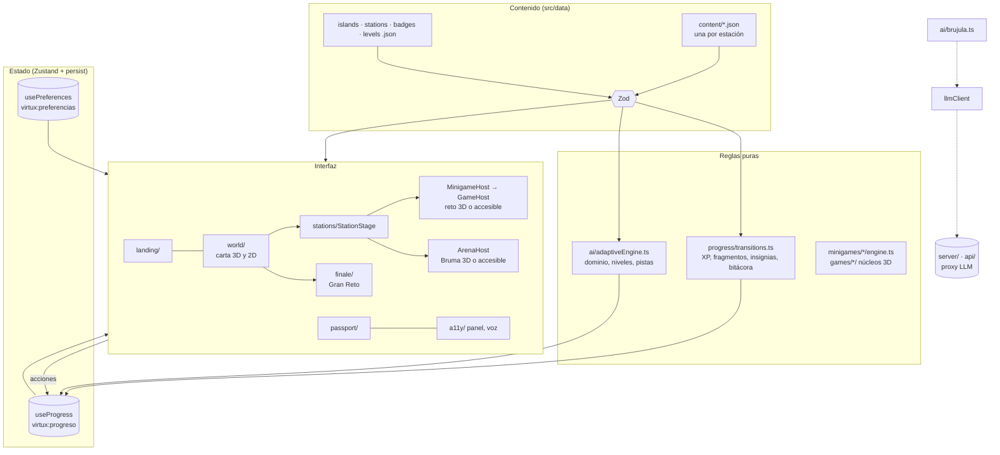
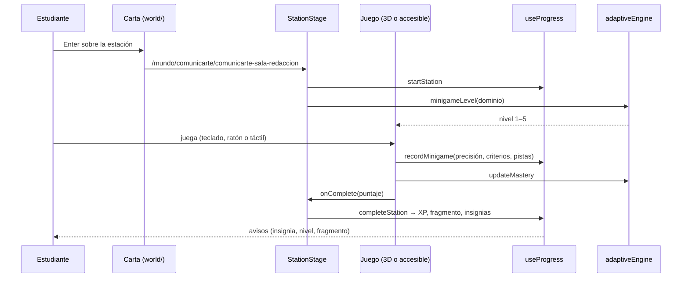

# Arquitectura

Una sola aplicación web (Vite + React 19 + TypeScript strict) que se despliega como sitio y se empaqueta como ejecutable con Electron. El contenido pedagógico es dato (JSON validado con Zod); las reglas son módulos puros probados; los componentes 3D solo leen el estado y emiten eventos (CLAUDE.md §14).

## Vista general

## Módulos

| Carpeta           | Responsabilidad                                                                                                                                                     |
| ----------------- | ------------------------------------------------------------------------------------------------------------------------------------------------------------------- |
| `src/app/`        | Rutas (carga diferida por ruta), layout, encabezado y pie institucionales                                                                                           |
| `src/data/`       | Contenido tipado: islas, estaciones, insignias, niveles y el contenido de cada estación; `validateWorld` cruza referencias                                          |
| `src/landing/`    | Landing cinematográfica: hero 3D, manifiesto, islas, cómo funciona, Brújula, DUA, pasaporte, CTA                                                                    |
| `src/world/`      | La carta: escena 3D (océano, islas, faro, rutas, marcadores, cámara), carta 2D equivalente, paneles y minimapa                                                      |
| `src/stations/`   | Escenario de estación a pantalla completa y los cinco tipos: explorar, practicar, reto, reflexionar, desafío                                                        |
| `src/minigames/`  | Versión accesible de los seis minijuegos y sus motores puros                                                                                                        |
| `src/games/`      | Versión 3D de cada reto y cada arena por isla, la plaza 3D de las demás estaciones (`stations/`) y las piezas comunes (`shared/`); ver [juegos-3d.md](juegos-3d.md) |
| `src/finale/`     | Gran Reto Integrador en el Faro Minuto: encadena las seis arenas                                                                                                    |
| `src/progress/`   | Store persistente, transiciones, insignias, niveles, modo demo                                                                                                      |
| `src/passport/`   | Pasaporte: sellos, fragmentos, bitácora, exportación PNG/PDF                                                                                                        |
| `src/ai/`         | Motor adaptativo, Brújula, cliente del proxy y prompts versionados; ver [ia.md](ia.md)                                                                              |
| `src/a11y/`       | Preferencias, panel (Alt + A), lectura en voz alta; ver [accesibilidad.md](accesibilidad.md)                                                                        |
| `src/ui/`         | Sistema de diseño: Button, Panel, Dialog, Toast, iconos, símbolos de estación                                                                                       |
| `server/`, `api/` | Proxy de IA (desarrollo y Vercel); la API key solo vive aquí                                                                                                        |
| `electron/`       | Proceso principal y preload del ejecutable; ver [ADR 0005](adr/0005-ejecutable-electron.md)                                                                         |

## Rutas

| Ruta                     | Qué es                                                                                                                  |
| ------------------------ | ----------------------------------------------------------------------------------------------------------------------- |
| `/`                      | Landing                                                                                                                 |
| `/mundo/:isla?`          | La carta y cada isla en la misma página: la cámara vuela sin desmontar el mundo; `?estacion=` y `?faro=1` abren paneles |
| `/mundo/:isla/:estacion` | Escenario de la estación, sin cromo institucional                                                                       |
| `/mundo/faro/gran-reto`  | Gran Reto Integrador                                                                                                    |
| `/pasaporte`             | Pasaporte del explorador                                                                                                |
| `/accesibilidad`         | Declaración de accesibilidad y ajustes                                                                                  |

Cualquier ruta acepta `?demo=1`, que precarga un recorrido de demostración (pregunta antes si ya hay progreso).

## Flujo de una estación

## Decisiones

Las decisiones de arquitectura están en [`docs/adr/`](adr/):

1. [Stack y versiones](adr/0001-stack-y-versiones.md)
2. [Enrutado](adr/0002-enrutado.md)
3. [Mundo navegable](adr/0003-mundo-navegable.md)
4. [Juegos 3D con versión accesible](adr/0004-juegos-3d.md)
5. [Ejecutable con Electron y protocolo propio](adr/0005-ejecutable-electron.md)

## Calidad

- **Vitest** (`tests/unit/`): transiciones del progreso, insignias, motor adaptativo, motores de minijuegos, núcleos de los juegos 3D, contenido, rutas y componentes de UI.
- **Playwright + axe** (`tests/e2e/`): landing, carta, recorrido solo con teclado, pasaporte, modo demo, panel de accesibilidad y Gran Reto, en escritorio y en móvil.
- **Ejecutable** (`tests/electron/`): abre el paquete, verifica el aislamiento y el modo sin red.
- **CI** (`.github/workflows/ci.yml`): lint, tipos, formato, pruebas, build y e2e en cada push. `release.yml` compila y prueba los ejecutables por tag.
