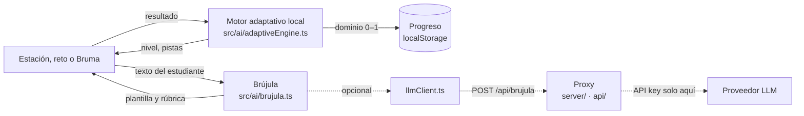

# Inteligencia artificial: Brújula y el motor adaptativo

El archipiélago tiene dos capas de IA. La primera es obligatoria y funciona sin red. La segunda es opcional y usa un modelo de lenguaje a través de un proxy. **El ejecutable y la web funcionan completos solo con la capa 1.** La capa 2 enriquece los textos, nunca decide si algo está bien o mal.



## Capa 1: motor adaptativo local (`src/ai/adaptiveEngine.ts`)

Es determinista y está probado con Vitest (`tests/unit/ai/adaptiveEngine.test.ts`).

### Dominio por competencia

Cada isla tiene una estimación de dominio `m ∈ [0, 1]`, que empieza en `0,3`. Se actualiza como un Elo de un solo jugador frente a ítems de dificultad `d ∈ [0, 1]`:

```
esperado = 1 / (1 + e^(−k·(m − d)))        k = 6
m'       = m + K · (resultado − esperado)
K        = 0,18 / √(1 + intentos / 4)
```

- La dificultad del ítem sale de su sutileza: nivel 1, 2 o 3 (`tierDifficulty`).
- El paso `K` se encoge con la práctica. Los primeros intentos mueven mucho la estimación y los siguientes la afinan, como en un BKT simplificado.
- Acertar un ítem difícil sube más el dominio que acertar uno fácil. Fallar uno fácil lo baja más.

El dominio se traduce en el nivel de competencia que muestra el pasaporte: Inicial (< 0,4), Intermedio (≥ 0,4) o Avanzado (≥ 0,75).

### Decisiones que toma

| Decisión                    | Regla                                                                                                      | Dónde                                  |
| --------------------------- | ---------------------------------------------------------------------------------------------------------- | -------------------------------------- |
| Dificultad de los retos     | `minigameLevel(m)`, de 1 a 5; cada juego la traduce a sutileza de las señales, recursos y número de rondas | Los seis minijuegos y sus versiones 3D |
| Fuerza de la Bruma          | `bossLevel`: sube un nivel por cada Bruma vencida y el dominio la ajusta un punto arriba o abajo           | Desafío de isla y Gran Reto            |
| Cuándo ofrecer pista        | Tras dos fallos seguidos, o tras uno si el dominio es bajo (`shouldOfferHint`)                             | Combates contra la Bruma y Gran Reto   |
| Otro formato                | Tras dos fallos con el mismo formato, Brújula propone otro (texto, audio, video, infografía, interactivo)  | Estaciones de exploración              |
| Siguiente estación sugerida | La primera en curso o disponible del sendero, marcada «Sugerida por Brújula»                               | Carta e isla (`nextStation`)           |

## Capa 2: Brújula con LLM (opcional)

Brújula (`src/ai/brujula.ts`) tiene dos versiones de cada función:

- **Local**: inmediata y sin red. Usa plantillas, la explicación de cada ítem y una rúbrica de señales para las reflexiones.
- **Con modelo**: pide al proxy un texto más rico. Si el proxy no responde, queda la local.

| Tarea           | Qué produce                                                         |
| --------------- | ------------------------------------------------------------------- |
| `brujula-retro` | Retroalimentación sobre una respuesta en la práctica o el combate   |
| `reflexion`     | Lectura de una reflexión abierta según los criterios de la estación |
| `informe-reto`  | Comentario de cierre de un minijuego                                |
| `bruma-linea`   | La voz de la Bruma en cada momento de la batalla                    |

Las entradas y salidas de cada tarea están en `src/ai/prompts/index.ts`, versionadas y validadas con Zod en los dos extremos. Si una respuesta no cumple el esquema, se descarta y se usa la local.

### El proxy (`server/` en desarrollo, `api/brujula.ts` en Vercel)

- **La API key vive solo en el servidor** (`.env`): nunca en el frontend ni en el ejecutable.
- **Proveedores** compatibles con la API de OpenAI y con plan gratuito: Groq (por defecto), Gemini u OpenRouter. También cualquier otro, con `LLM_BASE_URL`.
- **Protecciones**: límite de peticiones por IP y origen restringible (`ALLOWED_ORIGIN`).

### Cómo activarla

```bash
cp .env.example .env      # y pon LLM_API_KEY (por ejemplo, de console.groq.com)
pnpm server               # proxy en http://127.0.0.1:8787
pnpm dev                  # Vite reenvía /api al proxy
```

Sin `LLM_API_KEY`, o si el proxy falla, la interfaz muestra «Modo sin conexión» y todo sigue funcionando. Tras un fallo, el cliente espera un minuto antes de volver a intentar.

### El ejecutable

El preload de Electron marca la app como escritorio (`window.virtux.desktop`). Con esa marca, el cliente no intenta ninguna llamada de red y Brújula trabaja solo con la capa 1 (ADR 0005).

## Privacidad

- Al modelo solo se envía el texto de la respuesta o de la reflexión, la competencia y metadatos de nivel. Nunca se envían nombres, correos ni identificadores.
- El progreso y el dominio se guardan solo en el navegador o en el equipo (`localStorage`). No hay cuentas ni servidor de datos.

## Limitaciones y siguientes pasos

- El sendero sigue un orden fijo y Brújula sugiere la siguiente estación disponible. Reordenarlo según el perfil de interacción (explorador, enfocado, con dificultad) está en la hoja de ruta.
- La lectura local de reflexiones busca señales por criterio. Es transparente y explicable, pero no entiende paráfrasis lejanas; para eso está la capa 2.
